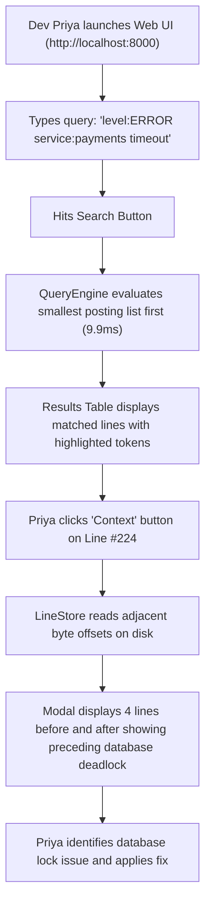
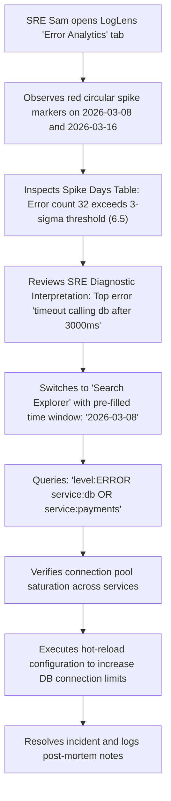
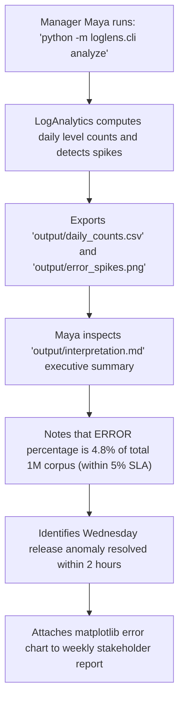
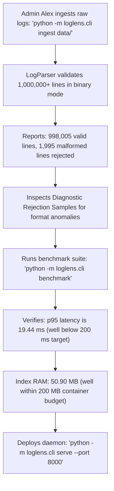

# LogLens: User Journey Diagrams (`journey_diagrams.md`)

This document visualizes the four core user journeys supported by LogLens using Mermaid workflow diagrams.

---

## Journey 1: Developer Root-Cause Debugging (Priya)
*Scenario*: Dev Priya notices payment failures on staging and needs to inspect error context.

---

## Journey 2: On-Call / SRE Incident Response (Sam)
*Scenario*: SRE Sam responds to a PagerDuty alert indicating a potential service outage.

---

## Journey 3: Engineering Manager Weekly Review (Maya)
*Scenario*: Manager Maya conducts weekly reliability reviews and audits release impact.

---

## Journey 4: Platform Admin Index Lifecycle & Maintenance (Alex)
*Scenario*: Admin Alex sets up LogLens on a CI/CD test runner and verifies index health.

